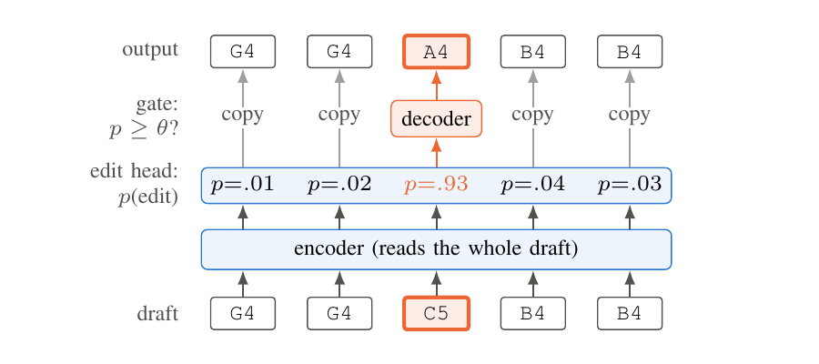
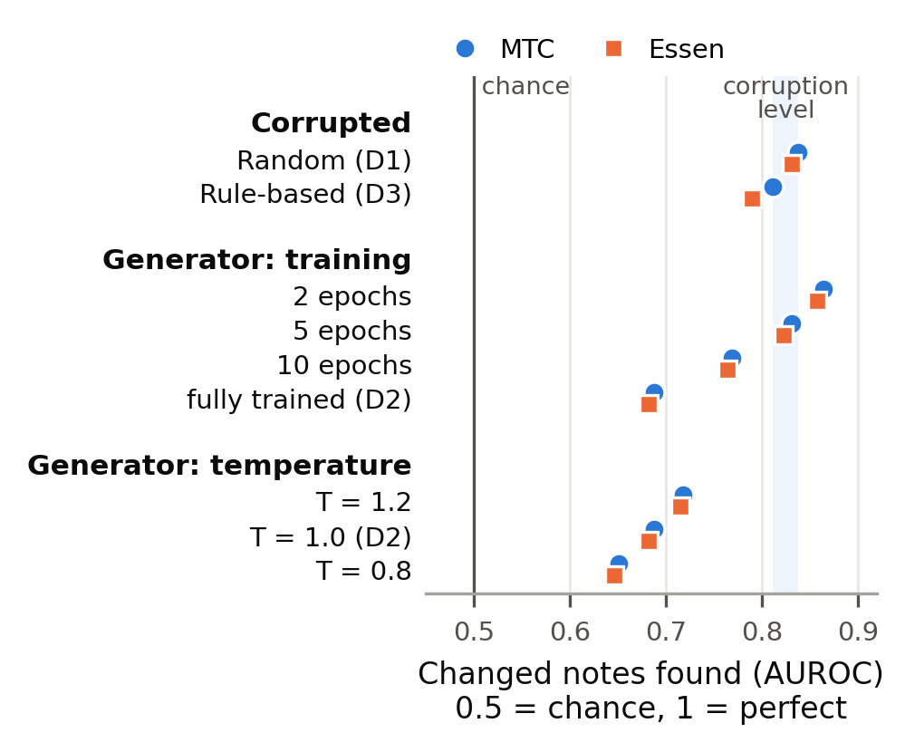

# The Better the Generator, the Less the Trace: When Does Localize-then-Fix Work for Symbolic Music Refinement?

## Abstract

To refine a draft melody is to change the few notes that are wrong and to leave the rest as they are. The natural framing is *localize-then-fix*: locate the faulty notes, then repair them. Systems of this kind are typically trained on melodies that have been synthetically corrupted, and judged by the edit distance of their output to the original. We examine both halves of this recipe on monophonic folk melodies. With a language model calibrated on human variants of the same tune serving as a plausibility judge, we show that edit distance cannot separate an error from a valid alternative. We then compare drafts produced by random corruption, by music-theoretic rules, and by a trained generator. Localize-then-fix succeeds where the changes leave a local trace, and the amount of trace a generator leaves depends on its quality: the better the generator, the harder its changes are to locate. Where the changes of a weak generator are found, the repairs make the music more plausible but seldom recover the original, so edit distance counts them as no gain. In a blinded listening study, listeners locate rule-based errors but not the changes a generator makes, and they hear those repairs as different rather than wrong. Finally, we propose a precision-gated refiner that copies each note unless it is confident the note is wrong. It improves corrupted drafts by about 6% on every seed, and it declines to edit generated drafts, the setting in which a standard sequence-to-sequence refiner does harm.

## 1. Introduction

Generative models of symbolic music can now produce plausible melodies on demand, yet a draft melody is seldom finished on its first render. Someone, a composer or another model, must decide which notes to modify and which to retain. This *refinement* problem differs from generation in a fundamental respect: the majority of the draft is already correct, and a system that regenerates it from scratch has not refined it. The natural formulation is therefore *localize-then-fix*: identify the incorrect notes and alter only those. Recent work has pursued this direction with models that detect and repair degradations in symbolic excerpts [McLeod2020], and with feedback models that select the weak notes of a composition for resampling [Ramoneda2024].

The standard recipe for building such systems relies on two assumptions. Training data is constructed by *corrupting* clean melodies through replacement, deletion or insertion of notes, and a model learns to reverse the damage. Evaluation measures the edit distance between the model's output and the original melody. The first assumption is that synthetic corruption is a stand-in for the errors present in real drafts; the second is that greater closeness to the original corresponds to higher musical quality. Neither has been tested directly, and both grow in importance as the drafts awaiting refinement increasingly originate from generative models rather than from hand-made corruption.

This paper examines three questions:

1. **Does edit distance to a reference measure improvement?** A melody may differ from its reference because it is incorrect, or because it is a distinct but equally valid rendition of the tune. If edit distance cannot separate these two cases, it cannot inform us whether a refiner has actually helped.
2. **When does localize-then-fix work?** If corrupted notes are locatable but a generator's mistakes are not, results obtained on synthetic benchmarks will not transfer to the drafts that refinement is ultimately meant to serve. We ask what determines whether the altered notes of a draft can be located at all.
3. **How should a refiner behave where it cannot localize?** A system that edits wherever its confidence is low risks damaging notes that were correct. We ask whether a refiner can be built to improve drafts where errors are locatable and to cause no harm where they are not.

To answer these questions, we study monophonic folk melodies, for which folk-song collections provide a rare resource: human variants of the same tune, which function as known-valid alternatives. We calibrate a plausibility judge on these variants, and then compare drafts from three sources (random corruption, music-theoretic degradation, and passages rewritten by a trained generator) under one model, one training recipe and one setting selected on validation data. We additionally vary how well-trained the generator is, to test whether localizability depends on generation as such or on the generator's quality. Because plausibility is scored by a language model, we verify in a blinded listening study (§7) the two conclusions that most depend on it: listeners perceive rule-based errors but only rarely a trained generator's changes, and they judge repairs that miss the reference no worse than the reference's own note. They also rarely perceive random corruption, so our claims about random corruption rest on edit distance and on the judge.

Our contributions are:

1. **A measurement.** A plausibility judge calibrated on human variants, and evidence that edit distance to a reference cannot distinguish an error from a valid alternative. We argue that it should be reported alongside plausibility and alongside the score obtained by simply returning the draft unchanged.
2. **A boundary.** A controlled comparison demonstrating that localize-then-fix applies where changes leave a local trace, and that the better the generator is, the less trace its changes leave. The finding holds for both trained and untrained detectors, under controls for how much damage a draft carries, and on a second corpus as well. A transfer test further shows that part of the score of any synthetic benchmark reflects the process that produced its errors rather than musical error as such.
3. **A method and its limit.** A precision-gated refiner that copies each note by default and edits only where it is confident. It improves drafts where errors are local, abstains where they are not, and, by construction, cannot do worse than returning the draft. On generated drafts, even the changes it does find are repaired toward the rewritten context rather than back to the reference, a gain that edit distance does not credit.

§4 addresses the first question. After §5 introduces the refiner, §6 and §7 address the second and the third, respectively.

## 2. Related Work

**Symbolic music correction.** The nearest preceding work is the MIDI Degradation Toolkit (MDTK) [McLeod2020], which introduces rule-defined degradations over symbolic excerpts and defines four tasks of rising difficulty: error detection, classification, localization and correction. Our random and music-theoretic draft sources fall into this family. In addition, we provide a measure of the extent to which a detector trained on such data comes to learn the corruption process itself rather than musical error (§7). RefinPaint [Ramoneda2024] is the closest analogue in method: a feedback model pinpoints the weaker elements of a composition and steers an inpainting model to resample them. We address the prior question of *when* such localization is feasible, and we find that for generated drafts the answer depends on the quality of the generator. The generated drafts we use are created by span infilling, following models that condition on arbitrary subsets of a score [Huang2017, Thickstun2023]; see [Ji2023] for a survey of symbolic generation.

**Edit-based sequence transduction and selective prediction.** When input and output share most of their content, predicting edits is a more precise objective than regenerating the sequence. Tagging models assign each input token a keep, delete or insert label [Malmi2019, Omelianchuk2020], while copy mechanisms allow the decoder to reuse the input directly [See2017]. Our gated decoder brings the two together: a per-note head decides *whether* an edit is applied, and the decoder contributes *what* to write only at positions where the gate opens, making copying the default instead of a behaviour the model must acquire. Forgoing edits in the presence of uncertainty corresponds to the reject option of classification [Chow1970], extended to deep networks as selective classification [Geifman2017], which we apply here at note granularity.

**Synthetic errors and reference-based evaluation.** Grammatical error detection is commonly cast as sequence labeling [Rei2016], and correction systems depend on synthetic errors for pre-training [Kiyono2019]. The realism of those errors is important: errors generated by a model trained on authentic learner errors improve detectors beyond the previous state of the art, and human readers have difficulty distinguishing them from real errors [Kasewa2018]. Our draft sources cover the same spectrum, from random to model-generated, and reveal a realism effect that is specific to refinement: the stronger the generator that produced a draft, the less local trace its changes leave. Reference-based evaluation introduces a second difficulty. Single-reference scoring in grammatical error correction systematically undercounts valid alternatives [Bryant2015], and code-repair benchmarks assess a patch by test outcomes rather than by its distance to a reference diff [Jimenez2024]. We quantify the musical counterpart of this issue (§4).

**Plausibility and its limits.** Long-standing work modelled melodic expectation as the information content of a note under a statistical model of a corpus [Pearce2005]. Our judge is a neural instantiation of this idea, calibrated against human variants of the same tune, and scoring each note with a masked, bidirectional model follows pseudo-log-likelihood scoring of text [Salazar2020]. Likelihood is an imperfect proxy for quality [Theis2016], and maximization-based decoding yields high-likelihood but degenerate text [Holtzman2020], a pattern we likewise observe in free decoding (§6). Since evaluating symbolic generation beyond likelihood remains open [Yang2020], we present edit distance and plausibility side by side, and validate the judge against human listeners (§7).

## 3. Task, Drafts and Representation

**Task.** A *draft* $M_0$ is a monophonic melody that differs from a *reference* $M^*$ in some of its notes. The refiner receives only $M_0$ and produces an output melody $\hat M$, which is expected to correct the faulty notes and leave the remainder intact. The conventional score is how much closer $\hat M$ lies to $M^*$ than $M_0$ did; whether that score actually measures improvement is what §4 examines, which is why we always report it together with plausibility.

**Corpora and splits.** The reference material comes from two collections of monophonic folk song. The Essen Folksong Collection [Essen] (8,469 melodies, averaging 54.5 notes) provides all training data. It is divided at random into two halves, one for the plausibility judge of §4 and one for the generator that writes D2 drafts, so that the judge never scores material the generator might have memorized. The refiners are trained on drafts from the judge's half (3,812 melodies, plus a further 423 held out for validation). The test set consists of the 360 melodies (49.0 notes on average) in the annotated edition of the Meertens Tune Collections (MTC-ANN) [MTC], organized into 26 *tune families*, groups of melodies believed to descend from a common ancestor through oral transmission. No model is exposed to MTC-ANN during training, so all headline results are cross-corpus. A within-corpus control (20% of Essen held out as test, with the judge and generator retrained on the remainder) is reported alongside every result from §6 onward.

**Draft sources.** Drafts are constructed in four ways (Table I), and each test reference yields three drafts for every source.

- **D1, random corruption.** One to five operations are applied, drawn as pitch replacement (40%), duration change (30%), deletion (15%) and insertion (15%). The new pitches and durations are sampled from the corpus's own distributions, so each edit is composed of typical corpus material even though its placement is random. This matches the random corruption used to build training data in prior work [McLeod2020], and serves as our primary control.
- **D2, generated.** A generator, a three-layer transformer language model trained on the other half of Essen, rewrites a span of 2–6 consecutive notes. It samples at temperature 1.0 conditioned only on the notes preceding the span, after which the reference resumes. The splice is deliberately unsmoothed: a passage that fails to rejoin its continuation is exactly the kind of flaw a realistic draft contains. Rewriting such a short span changes 10.6% of a melody on average. By contrast, letting the generator continue freely from a prefix rewrites 89% of the melody, a distance as large as between two variants of a tune, which leaves no draft to refine. To vary the quality of the generator, §7 additionally draws D2 drafts at temperatures 0.8 and 1.2, and from the same generator's checkpoints after 2, 5 and 10 training epochs (at temperature 1.0). Unless otherwise specified, "D2" denotes the fully trained generator at temperature 1.0.
- **D3, rule-based musical degradation.** One to five applications of six rules are made, each one a violation that music theory names: an out-of-scale pitch given the annotated key, a leap exceeding 14 semitones, a structurally strong note displaced off the beat, a broken final cadence, a varied rhythm flattened to uniform durations, and a figure collapsed into a repeated pitch.
- **D4, human variants.** Pairs of melodies from the same tune family (1,012 pairs, at most 40 per family) are used. Both members are attested versions of the tune, so neither counts as an error; they serve only to calibrate the judge (§4). Because family members differ in metre and length, they are variants of the same tune rather than a draft and its revision, and they are never refined.

**Table I.** Draft sources on the MTC test set (three drafts per reference; D4 comprises the 1,012 variant pairs). Changed is Correction Cost divided by reference length, approximately the fraction of notes affected.

| source | how the draft is made | mean CC | changed |
|---|---|---|---|
| D1 random | 1–5 random edits | 2.98 | 6.6% |
| D2 generated | 2–6 notes regenerated | 4.71 | 10.6% |
| D3 rule-based | 1–5 rule violations | 4.11 | 9.1% |
| D4 human variants | another version of the tune | 45.7 | 92.3% |

**Representation.** A melody is a sequence of events; each event carries a pitch (or an explicit rest) and a duration measured in integer ticks at a rate of 24 per quarter note, a resolution that captures every duration in both corpora exactly. Every event is mapped to two tokens, a pitch-or-rest token and a duration token, and a bar token is inserted at points where the annotated metre opens a new bar (Table II), which limits how far a duration mistake can shift subsequent notes. The vocabulary contains 121 tokens: 76 pitches, 40 durations, the rest, the bar, and three special tokens. Bars are structural, not events: an edit never inserts or removes a barline, and a displaced onset is represented as a duration change.

**Table II.** The opening of an MTC melody (4/4, starting on an upbeat) rendered as tokens, together with a draft of it containing two edits (bold). Durations are in ticks at 24 per quarter note; `BOS` and `EOS` are omitted. The Correction Cost of the draft is 2.

| note | G4 | | G4 | A4 | B4 | B4 | | B4 | rest | D5 | D5 |
|---|---|---|---|---|---|---|---|---|---|---|---|
| reference | P67 | BAR | P67 | P69 | P71 | P71 | BAR | P71 | REST | P74 | P74 |
| | D24 | | D24 | D24 | D36 | D12 | | D48 | D24 | D18 | D6 |
| draft | P67 | BAR | P67 | **P72** | P71 | P71 | BAR | P71 | REST | P74 | P74 |
| | D24 | | D24 | D24 | D36 | D12 | | **D24** | D24 | D18 | D6 |
| label | keep | | keep | edit | keep | keep | | edit | keep | keep | keep |

*(Reference is MTC-ANN `NLB070535_01`, tokenized by the paper's tokenizer. The draft is illustrative: one pitch substitution, A4 → C5, and one duration substitution, a half note shortened to a quarter. LaTeX label `tab:example`.)*

**Alignment and Correction Cost.** Two melodies are aligned event by event with the Wagner–Fischer algorithm [Wagner1974], a simplified variant of the musical edit distance of Mongeau and Sankoff [Mongeau1990] that omits its fragmentation and consolidation operations. Insertion, deletion, pitch substitution and duration substitution are each assigned cost 1, so an event differing in both pitch and duration costs 2. *Correction Cost* (CC) is this minimal total cost. The same alignment yields the training labels for the refiner: each draft event receives a *keep* or *edit* label (Table II)—a collapse of the five original types that §5 shows to be redundant—and a final end-of-sequence slot collects the labels for notes absent after the last draft event.

**Evaluation.** Our primary metric is the relative reduction in mean CC compared with returning the draft unchanged (*copy-input*, B3):
$(\overline{\mathrm{CC}}(M_0, M^*) - \overline{\mathrm{CC}}(\hat M, M^*)) \,/\,
\overline{\mathrm{CC}}(M_0, M^*)$
so that positive values indicate that the refiner outperforms doing nothing. We additionally report *fidelity*, the CC between the output and the draft, which separates a refiner that edits from one that regenerates; per-melody win and loss rates; and plausibility as scored by the judge of §4. All results are averages over five training seeds for the headline figures and three for secondary comparisons, under a single configuration chosen on validation data (§5).

## 4. Measuring Plausibility

Edit distance indicates how far a draft lies from its reference, but not whether it is inferior. This section takes up the first question raised in §1, namely whether edit distance to a reference measures improvement. Answering it requires a second, reference-independent measure of how plausible a melody is. We employ a language model as a judge, calibrated against melodies known to be acceptable; §7 evaluates it against human listeners, whose naturalness ratings track it in direction, if only loosely.

**The judge.** $J$ is a decoder-only transformer language model over the token sequence defined in §3 (four layers, hidden width 256), trained on the judge's half of Essen with early stopping on held-out Essen melodies. It shares no training data with the generator that writes D2 drafts, which is trained on the complementary half and, in addition, has three layers instead of four; a judge trained on the generator's data could merely recognise its outputs. $J$ scores a melody by its mean negative log-likelihood (NLL) per token—per token because insertions and deletions change sequence length—and scores a draft by how much less plausible it is than its reference:

$$\Delta\mathrm{NLL}(M_0) = \mathrm{NLL}_J(M_0) - \mathrm{NLL}_J(M^*). \qquad (1)$$

Values above zero indicate that the draft is less plausible than its reference. Both melodies receive the barlines implied by the reference's metre, so neither has an annotation advantage. $J$ scores MTC melodies 0.137 nats per token worse than Essen. Because ΔNLL is a paired difference, this offset cancels; the gap may nonetheless make $J$ more sensitive to change on MTC than on its own corpus. The same-corpus control of §3 removes the gap, and every judge-based result from §6 onward holds under it. $J$ scores complete melodies; to score individual notes, §7 supplements it with a two-sided judge that attends to the context on both sides.

**Calibration on human variants.** A judge that penalised every departure from the reference would label every alternative an error, and would be useless for our question. We therefore score the D4 pairs, in which both members of a tune family are attested versions of the tune. Their ΔNLL has a mean of +0.054 and a median of +0.031, and 45.0% of pairs score at or below zero: the judge is near-indifferent between versions that differ in 92% of their notes. It measures degradation, not difference. We place a degradation threshold $\tau$ at the 95th percentile of the variants' ΔNLL, $\tau = 0.585$, so that a draft exceeding $\tau$ is less plausible than 95% of human alternatives. (Resampling which variant pairs are drawn shifts $\tau$ by about 0.02.) Since the variant pairs come from the test corpus, $\tau$ is used only to bucket drafts for analysis, never for training or model selection.

**Table III.** Draft sources under the judge (MTC). *Per unit* is the median of ΔNLL divided by the fraction of notes changed (Table I); $\rho$ is the Spearman correlation between fraction changed and ΔNLL across drafts, with a 95% interval obtained by resampling tune families.

| source | ΔNLL mean | per unit | ΔNLL ≤ 0 | ΔNLL > τ | ρ [95% CI] |
|---|---|---|---|---|---|
| D4 human variants | +0.054 | +0.04 | 45.0% | 5.0% | +0.14 [+0.04, +0.24] |
| D1 random | +0.298 | +3.94 | 5.2% | 13.0% | +0.52 [+0.46, +0.59] |
| D3 rule-based | +0.271 | +3.14 | 4.2% | 9.6% | +0.47 [+0.41, +0.52] |
| D2 generated | +0.139 | +1.04 | 20.5% | 2.6% | +0.20 [+0.11, +0.30] |
| all pooled | | | | | −0.06 [−0.11, −0.01] |

**Corruption is damage, but of an unrealistic kind.** A common objection to random corruption is that a replaced note may simply yield a valid alternative. Table III does not bear out that objection: 95% of D1 drafts are less plausible than their references. The issue lies on the opposite side. Random and rule-based corruption alter 7–9% of a melody at a ΔNLL of 3–4 per unit of change, roughly two orders of magnitude greater per unit than a human variant (whose per-unit median is close to zero, so the precise ratio is ill-conditioned). Corruption displaces a melody a short distance *off* the set of plausible melodies; human variation displaces it a long distance *along* it. Generated drafts fall in between, at about 1 per unit, and 79.5% of them are less plausible than their reference. Because $\tau$ is calibrated on variants that differ in 92% of their notes, it is a conservative bar for drafts that change a tenth as much: only 13.0% of D1 drafts exceed it, although 95% are degraded. We therefore use $\tau$ to certify degradation, never to declare a draft error-free.

**Edit distance cannot tell an error from an alternative.** Within a single corruption process, more change does imply more damage: fraction changed and ΔNLL correlate at $\rho \approx 0.5$ for D1 and D3, partly by construction, as the number of injected edits drives both quantities. Between sources the relationship vanishes and even weakly reverses ($\rho = -0.06$ when pooled): the melodies most distant from their references, the human variants, are the most plausible. The comparison is sharpest at matched distances, though the evidence there is limited: the nine variant pairs differing in fewer than 20% of their notes have median ΔNLL 0.000, versus +0.18 for synthetic drafts in the same range.

The answer to the first question is therefore: only within a single draft source. Edit distance to a reference can rank methods on one source, but it cannot compare sources against each other, nor say whether a particular deviation is a correction or a valid alternative. We accordingly report both Correction Cost, for comparability with prior work, and ΔNLL, for whether the music became more plausible. ΔNLL carries its own bias: it favours typical notes, so it can prefer a refiner that writes the most probable note over the reference's (§6). §8 examines its limits further.

## 5. Method

**Figure 1 (placed at the top of §5).** `figures/refiner.tex` (TikZ, `\input` from `main.tex`; preview `figures/refiner.png`). One column wide. Five draft events (the opening of Table II's draft) pass through the encoder to the edit head, which shows a probability per event; four are copied straight to the output, and the one above the threshold (C5, $p = .93$) goes to the decoder, which writes A4. Blue is the model, orange the edited event.

**Caption.** Gated decoding applied to the draft of Table II. The edit head assigns each event a probability $p$ that the event requires editing. Events with $p < \theta$ are carried over unchanged; the decoder writes a replacement only where $p \ge \theta$ (here C5 becomes A4). The displayed probabilities are illustrative; bar tokens are always copied.

**Refiner.** The refiner (Fig. 1) is an encoder–decoder transformer (three encoder and three decoder layers, hidden width 256, four heads; 5.86M parameters). The encoder takes in the full draft, and the decoder emits the corrected melody one token at a time while attending to the encoded draft; it is trained with teacher forcing against the reference. An encoder–decoder architecture fits this task for two reasons: deciding whether a note is wrong requires looking at the notes that follow it, and a draft and its reference have different lengths whenever a note has been inserted or deleted, so position-by-position alignment is impossible.

**Edit head.** A linear layer on the encoder output assigns, to each draft event, a probability $p$ that it requires an edit. It is supervised by the keep/edit labels of §3, and the model is optimised on

$$\mathcal{L} = \mathcal{L}_{\text{gen}} + \alpha\,\mathcal{L}_{\text{edit}}, \qquad (2)$$

where $\mathcal{L}_{\text{gen}}$ is the cross-entropy over the reference's tokens and $\mathcal{L}_{\text{edit}}$ the cross-entropy over the labels. The head contributes 514 parameters. A five-way head that also predicts the type of edit does not do better ($+0.10 \pm 0.36$ points, seed-matched) and never predicts an insertion correctly, so we use the binary head throughout.

**Gated decoding.** The standard way to use such a model is free decoding, in which the decoder rewrites the melody in full. However, most of a draft is already correct, and every note the decoder rewrites is another opportunity to make an error. We therefore make copying the default (Fig. 1). An event with $p < \theta$ is copied through verbatim. An event with $p \ge \theta$ is delegated to the decoder, which writes a replacement event in its place, conditioned on the encoded draft and on everything emitted so far. Bar tokens are always copied. Decoding is greedy, under a mask that enforces the alternation of pitch and duration tokens.

This construction has a useful property. With a threshold that no probability can reach, the gate never opens and the output *is* the draft: gated decoding thus contains copy-input as a special case, so its worst setting amounts to doing nothing. Lowering $\theta$ trades coverage against risk, as in selective classification [Geifman2017], and what determines whether each additional edit is helpful is the head's precision among its most confident predictions, not its overall accuracy. In this form the gate only substitutes events; it neither inserts nor deletes, which limits what it can repair (§8).

**Baselines.** B1 is the same encoder–decoder without the head, decoded freely: plain sequence-to-sequence imitation. B2 keeps the head but is trained with $\alpha = 0$, so it has exactly the refiner's parameters and differs only in the loss. B3 returns the draft unchanged (copy-input). We also report the edit-aware model under free decoding, which separates what the loss changes from what the gate changes. B3 and fidelity are not optional: in a preliminary sweep on generated drafts, an auxiliary edit loss beat B1 by 6.3% on every seed merely because it had learned to copy the draft (0.0009 notes changed per note)—something nothing else would have revealed.

**One setting, chosen on validation.** The loss weight $\alpha$, the threshold $\theta$ and the weighting of the rare edit class in $\mathcal{L}_{\text{edit}}$ interact, and selecting them on test results would inflate every number that follows. We therefore select them once, on D1 validation drafts only, across four class weightings, four values of $\alpha$ and six of $\theta$ (96 settings, three seeds each), by lowest mean gated Correction Cost. The chosen setting (no class weighting, $\alpha = 0.5$, $\theta = 0.8$) is applied unchanged to every draft source and both corpora. The landscape is flat: every class weighting falls within 0.2 points of the best, and 84 of the 96 settings improve on copy-input on every seed. Models are trained with AdamW (learning rate $3 \times 10^{-4}$, batch 32) for at most 40 epochs, with early stopping on validation loss. Runs are not bit-reproducible on GPU; two complete re-runs differ by at most 0.36 points in any cell mean.

## 6. Results I: Where Localize-then-Fix Works

The bracketed values in all tables are, per §3, the same-corpus control, with the judge, the generator and the test melodies all from Essen; each of the conclusions below holds on both.

**Table IV** (now single-column; replaces the full-width version). Improvement in mean Correction Cost over returning the draft (copy-input), %, mean over five seeds; positive is better. MTC (Essen in brackets). Gated editing improves on copy-input on all five seeds in every D1 and D3 cell (s.d. 0.27–0.58); on D2 its gate never opens.

| system | D1 random | D3 rule-based | D2 generated |
|---|---|---|---|
| B1 imitation, free | −24.9 (−92.2) | +3.9 (−22.3) | −3.6 (−27.1) |
| B2 (α = 0), free | −18.8 (−90.1) | +5.3 (−21.8) | −5.7 (−26.1) |
| edit-aware, free | −17.8 (−92.4) | +4.0 (−22.7) | −4.2 (−25.6) |
| **edit-aware, gated** | **+6.06 (+4.25)** | **+9.81 (+7.38)** | 0.00 (0.00) |

**Gated editing improves drafts where errors are local.** On random corruption, gated decoding cuts the Correction Cost by 6.06% relative to the draft on MTC (±0.58) and by 4.25% same-corpus (±0.46), on each of the five seeds (Table IV). It improves 22.4% of melodies and worsens 6.5%, leaving the rest untouched, and alters about 1.5% of the notes, a third of what free decoding changes. Of the events routed to the decoder, 82% were genuinely wrong. The setting selected on D1 validation carries over to the other sources unchanged.

**The operating point is not delicate.** Sweeping the threshold on the test set—not for selection but as a description—gated editing beats copy-input on every seed at every threshold from 0.2 to 0.95, on both corruption sources and both corpora (D1: +5.0 to +6.4% on MTC, +2.7 to +4.6% on Essen; D3: +8.9 to +10.3% and +6.5 to +7.3%). Nor does the gain depend on model size: gated editing beats copy-input on D1 on every seed in all nine configurations we tried, from 1.6M to 42.7M parameters (at the earlier θ = 0.9), whereas free decoding is worse than copying in all nine.

**Free decoding is worse than doing nothing.** On random corruption, every freely decoded model is worse than returning the draft, on every seed: the imitation baseline B1, by 25% on MTC and by more than 90% same-corpus. It rewrites notes that were right. The edit-aware loss does not rescue it: with the head trained (α = 0.5) or present but untrained (B2), free decoding stays within the seed noise of B1 in every cell. The gain of gated editing comes from making copying the default; the loss's contribution is a head confident enough to gate with.

**How much is left.** An oracle—the same architecture trained and tested with the true edit positions as input—removes 49.3% of the draft's Correction Cost on D1 (single run, earlier configuration). Gated editing's 6.1% is roughly an eighth of that headroom, and the gap lies mainly in localization.

**Better music, not only closer to the reference.** A Correction Cost gain could come from edits the judge finds implausible. It does not. On the melodies it changes, gated editing removes 30% of the draft's ΔNLL on D1 and 48% on D3, and makes fewer than 3% of them less plausible (seeds 0–2; Table VII). Free decoding removes *more*, 41% on D1, while being 25% worse than copying on Correction Cost. The two measures disagree because free decoding is greedy and drifts toward the model's most typical continuation: 14.5% of its D1 outputs score as more plausible than the reference itself (against 5.2% of the drafts), and a third of the melodies it changes end up both more plausible and further from the reference (one seed). This is the dissociation of §4 once more, now in the model's own outputs. An evaluation on plausibility alone would prefer free decoding; one on Correction Cost alone would hide that gated editing improves the music. On random corruption, gated editing is the only system that beats the draft on both.

**D3 is easier, but its in-domain gain overstates it.** The largest gains for gated editing are on rule-based degradation: 9.81% on MTC and 7.38% same-corpus, on every seed. Part of this is intrinsic: a head trained only on random corruption improves D3 drafts by +7.25%, more than the drafts it was trained on. Part is not: a head trained on D3 itself reaches +9.98% (seeds 0–2). Transfer loses roughly a quarter of the in-domain gain in both directions (D1 to D3, 27%; D3 to D1, +4.80% versus +6.35%, i.e. 24%), so rule-based corruption is not unusually circular: *every* synthetic benchmark we built rewards learning its own corruption process by about a quarter of its in-domain score.

**Generated drafts.** On D2 the gate never opens: the output coincides with the draft on every seed, so gated editing neither helps nor harms, while free decoding loses 3.6% and 27.1%. No other threshold helps either: lowering it to 0.2 opens the gate on 3% of events at a precision of 0.17 and worsens the drafts on every seed (−1.0% on MTC, −1.1% on Essen), and from 0.5 upward the gate barely opens at all. Abstention is learned rather than guaranteed: heads trained on D1 or D3 and applied to D2 *do* open the gate, at a precision of 0.27 and 0.21, and worsen the drafts by 1.7% and 2.0% on every seed. §7 explains why no operating point exists.

*Removed from §6: the output-quality table (old Table V). Its gated "recovered" values are the repair table's last column (§7), and its free-decoding values (41% on D1) are in the text above. Moved into §6 from §7: the transfer results ("What training adds"), split between the D3 paragraph and the generated-drafts paragraph.*

## 7. Results II: Where It Does Not

For generated drafts, the gate stays closed throughout. The aim of this section is to explain that outcome. A weak detector, an insufficient amount of damage, and the fact that the changes form contiguous runs are each excluded as the cause. What remains is that how findable a change is tracks the quality of the generator that wrote it, and that finding a change still does not suffice to recover the reference. Listeners are then used to test these conclusions.

**Table V** (full width, unchanged). How well each detector ranks the notes that differ from the reference, on MTC, with the Essen control in brackets. Cells report AP lift — average precision divided by the base rate of edited positions, so that 1.0× equals chance — together with AUROC. Neither judge is ever trained on edit labels.

| detector | D1 random (6.0% edited) | D3 rule-based (8.2%) | D2 generated (7.3%) |
|---|---|---|---|
| trained head | 5.8× / .724 (5.6× / .727) | 4.6× / .726 (4.3× / .717) | 1.6× / .636 (1.8× / .658) |
| causal judge, untrained | 4.1× / .775 (4.9× / .774) | 4.7× / .768 (5.1× / .756) | 1.4× / .561 (1.4× / .564) |
| two-sided judge, untrained | **6.2× / .838** (7.0× / .831) | **5.9× / .812** (6.1× / .790) | **2.7× / .688** (2.7× / .683) |

**Drafts from a trained generator carry little local trace.** Notes introduced by corruption are easy to rank: the trained head places them at 4.6–5.8× chance (Table V). Notes written by the generator are a different matter. A head trained on D2 ranks them at only 1.6× chance, and under the selected setting its confidence never rises far enough for the gate to open. That holds even though D2 drafts have a *higher* share of changed positions than D1 drafts, 7.3% against 6.0%. With an identical loss and a larger supply of positive examples, the head still has nothing it is prepared to act on. Other trained detectors do no better. A span-level model trained to locate the rewritten span itself reaches only 1.6× chance at top-1, and that is with the span's length range given to it. Heads trained on D1 or on D3 rank D2's changes at 1.3–1.4×.

**The failure is not a missing detector.** The best localizer we constructed received no edit supervision whatsoever. It is a two-sided judge: a masked language model matching $J$ in size and in training data, which scores a note from all of the remaining notes in the melody. It beats the trained head on every source and on both corpora. If anything, this comparison is generous to the head, since bringing the head's scores onto the same within-melody scale the judge already uses *reduces* the head's AUROC. Even so, the judge manages only 2.7× chance on D2, set against 6–7× on corruption. Model capacity is not the constraint either, at least where localization does succeed: on random corruption, localization precision stays flat over a 26-fold span of model sizes (measured at the earlier θ = 0.9; the sweep was not repeated for D2).

**The damage is diffuse, not merely smaller.** A tempting reading would drain the result of interest. Generated drafts might simply be less damaged than corrupted ones — mean ΔNLL 0.14 against 0.30 — and any kind of damage might become detectable once it is large enough. Restricting the analysis to bands within D2 cannot settle this, because a localizer built on surprisal will find high-ΔNLL drafts easier almost automatically. Table VI instead applies the *same* absolute ΔNLL cut-points to every source, using newly drawn sets of roughly 5,300 MTC drafts per source together with the Essen test drafts. Corrupted and generated drafts are thereby compared at equal degradation.

**Table VI** (one column, unchanged). Localization at matched degradation. AUROC of the untrained two-sided judge on notes that differ from the reference; drafts are grouped by the causal judge's ΔNLL, with identical cut-points for every source. MTC, Essen in brackets. τ is the §4 threshold: 0.585 on MTC and 0.503 for the same-corpus judge.

| ΔNLL band | D1 random | D3 rule-based | D2 generated |
|---|---|---|---|
| ≤ 0 | .753 (.722) | .638 (.618) | .606 (.579) |
| 0 – 0.1 | .830 (.826) | .774 (.740) | .684 (.670) |
| 0.1 – 0.2 | .844 (.834) | .807 (.801) | .727 (.728) |
| 0.2 – 0.4 | .855 (.837) | .825 (.816) | .730 (.724) |
| 0.4 – τ | .845 (.831) | .838 (.831) | .748 (.738) |
| > τ | .861 (.855) | .850 (.838) | .775 (.779) |

That reading fails. Generated changes are ranked below corrupted ones in every band and on both corpora, trailing D1 by 0.08–0.16 AUROC, and this despite D2 drafts altering *more* notes than D1 drafts inside the same band (8.8–13.1% against 3.9–9.4% on MTC). The most degraded D2 band still falls short of the least degraded positive band of random corruption. Once a randomly corrupted draft is worse than its reference at all, localization barely moves (0.83–0.86). For generated drafts it increases only gradually with damage and never attains that range. Identical damage, when a generator is what wrote it, leaves a weaker trace on the notes that actually changed. (Across bands the trained D2 head barely moves, staying between 0.62 and 0.67; the gradient belongs to the judge.)

The distribution of the damage shows where the trace goes. Once a span has been rewritten, the notes that follow it — notes that were *not* changed — also lose plausibility under the causal judge, by +0.07 per token, against +0.22 inside the span. Taken one by one, the span's notes are plausible. The implausibility lies in how the span joins its surrounding context, and part of that cost lands on notes that the labels derived from the reference mark as correct. A causal model therefore bills the wrong notes. Seeing both sides of the join, the two-sided judge doubles D2 localization, from 1.4× to 2.7×. What has already spread past the changed notes, however, it cannot bring back.

**Contiguity hurts localization without accounting for D2.** Changes written by the generator arrive in runs of 2–6 notes, whereas random corruption mostly touches isolated notes, and errors that run together are harder to rank. Inside D3, the judge's AUROC drops from 0.94 on isolated changes to 0.75 on runs of three or more (0.92 to 0.72 on Essen). Matching on run length does not remove the gap. On runs of three or more, the judge reaches 0.68 for D2 against 0.75 for D3 (0.68 against 0.72 on Essen), and the trained head 0.64 against 0.71. Restricting to drafts in which no two changed notes are neighbours, the judge reaches 0.75 on D2, against 0.84 on D1 and 0.94 on D3 (0.73, 0.83 and 0.92 on Essen).

**Figure 2** (one column). `figures/figure2.pdf`, produced by `scripts/figure2.py`. A dot plot with one row per draft condition and MTC plotted beside Essen. The rows are *Corrupted* (random D1 and rule-based D3), *Generator: training* (checkpoints at 2, 5 and 10 epochs, plus the fully trained D2, all at T = 1.0), and *Generator: temperature* (T = 1.2, T = 1.0, which is D2, and T = 0.8, all from the fully trained model). The horizontal axis is the AUROC of the untrained two-sided judge, with 0.5 marking chance, and a shaded band indicating the corrupted drafts. Panel (b) of the earlier figure, which plotted gated gain per source, duplicated Table IV and has been removed.

**Caption.** How reliably an untrained judge, scoring each note from its surrounding context, identifies the notes that differ from the reference. AUROC is shown, with 0.5 as chance and 1 as perfect, for MTC and for the same-corpus Essen control. Drafts come from random corruption (D1), from rule-based corruption (D3), or from a generator whose training length is varied at T = 1.0 and whose sampling temperature is varied once fully trained. D2 is the fully trained generator at T = 1.0. The shaded band indicates the corrupted drafts. The longer a generator has been trained, the harder its changes become to find.

**A better generator leaves less behind.** Up to this point the comparison is between a single generator and corruption. Fig. 2 instead varies the generator: three sampling temperatures, plus three checkpoints stored early in training, each scored by the untrained judge in exactly the way D2 is scored. As the generator worsens, localizability climbs steadily. The AUROC is 0.65 at temperature 0.8, 0.69 for D2 and 0.72 at temperature 1.2, then 0.77, 0.83 and 0.87 at the checkpoints after 10, 5 and 2 epochs (0.65 to 0.86 on Essen, in that same order). The generator's own quality measure produces the same ranking: held-out NLL declines from 1.84 after 2 epochs through 1.70 and 1.50 to 1.23 for the trained model (1.91 down to 1.32 for the same-corpus generator). Two reservations should be stated. Because the judge and $J$ share training data, some of the agreement between the judge and $J$'s estimate of how implausible the changes are is guaranteed in advance. A detector that depends on neither — the head trained on the edit labels of random corruption and then applied with no further training — moves in the same direction, from 0.57 at temperature 0.8 up to 0.64 for the 2-epoch generator (0.61 to 0.68 on Essen), but the slope is far gentler. For this detector, drafts from even the weakest generator remain well below random corruption, which sits at 0.73. The judge, by contrast, ranks the 2-epoch generator's drafts *above* random corruption, 0.87 against 0.84. The difficulty of localizing D2 is therefore not a property of generation in general but of generation by a good model, and the distance between a weak generator and corruption depends on which detector is asked. Pooling all eight conditions, localizability increases sharply with the implausibility of the changes per unit of change until roughly 2 per unit, after which it flattens at 0.81–0.87, the region occupied by both corruption sources and by the undertrained generator.

**Table VII** (now one column; previously full width). The note the decoder emits at positions where the gate opens. *Exact* is the share of gate-opened true substitutions for which the output matches the reference's note. *≥ ref.* is the share of the remaining, non-matching repairs that the two-sided judge judges at least as plausible as the reference's note. *Recovered* is the share of ΔNLL removed among the melodies that were changed. Seeds 0–2; MTC, with Essen in brackets.

| drafts | exact | ≥ ref. | recovered |
|---|---|---|---|
| D1 random | **59%** (58%) | 49% (49%) | 30% (31%) |
| D3 rule-based | **44%** (41%) | 39% (40%) | 48% (53%) |
| D2, 2-epoch generator | **11%** (13%) | **64%** (68%) | 28% (36%) |

**The repair fits the context, not the reference.** Were localizability the entire explanation, gated editing ought to succeed on drafts from the 2-epoch generator. Measured by edit distance, it almost entirely fails to. Trained on those drafts with the setting held fixed, refiners gain −0.13% ± 0.24 over copy-input on MTC, with only one of three seeds positive, and +0.38% ± 0.30 same-corpus, with all three positive. That is a tenth of the gain the same method records on random corruption. Free decoding, meanwhile, loses 11% and 28%. The shortfall has two parts. First, the trained head ranks these drafts below the judge, with AUROC 0.67–0.81 across seeds and corpora against the judge's 0.86–0.87, so the gate opens at a precision of 0.59–0.72 rather than the 0.82 seen on D1. Second, even at a changed note the gate has correctly found, the decoder seldom reproduces the reference's note (Table VII): it does so 11–13% of the time, against 58–59% under random corruption and 41–44% under rule-based degradation. This should not be read as simple failure. According to the judge, gated editing eliminates 28% of these drafts' implausibility on MTC and 36% on Essen, and 85–88% of the melodies it alters become more plausible. Where a repair misses the reference, the two-sided judge rates the decoder's note far above the draft's, with median surprisal 2.3–2.4 against 10.7–11.1, and rates it at least as plausible as the reference's own note in 64–68% of cases (median 3.3–3.9). Within a rewritten span, the reference's note is no longer the best-fitting choice: the notes around it were rewritten as well, and the decoder produces a note consistent with those new neighbours. A corrupted note is constrained by the untouched notes on either side of it. The original of a rewritten span, by contrast, is only one of many plausible continuations, and nothing in the draft indicates which of them the reference chose. The oracle points the same way. Supplied with the true positions, it removes 49% of D1's Correction Cost but only 21.5% of D2's. Edit distance registers none of this as an improvement. Because the judge favours typical notes, it may prefer these repairs for that reason alone; the next experiment asks whether listeners hear them as wrong.

**Listening study.** Two claims in this section depend on the judge: that changes written by a generator leave less of a trace than corruption does, and that a repair which fails to recover the reference is not thereby an error. Both were put to listeners. Six raters completed a blinded listening test on MTC test material, in 17 sessions spread over five balanced rounds, giving each item three or four ratings.

There were two tasks.
- **Excerpts.** Raters heard 100 excerpts, each of 20 notes at most, with 20 drawn from each of D3, D1, D2, the 2-epoch generator, and unaltered references. Every excerpt includes the whole of its draft's changes, and each comes from a different tune. Raters marked whichever notes sounded wrong, or marked none, and gave a naturalness rating from 1, clearly wrong, to 5, natural.
- **Pairs.** Raters heard two renderings of one excerpt, differing at a single highlighted note, and picked the better rendering or declared no preference. Forty of the pairs opposed a gated repair of a 2-epoch draft, one that had missed the reference, to the reference's own note in identical context. Ten further pairs served as a check, opposing the repair to the draft note it had replaced.

**Table VIII** (one column, new; `tab:listening`). The excerpt task of the listening study. *Nat.* is mean naturalness, from 1 (clearly wrong) to 5 (natural). *None* is the share of ratings marking nothing. *Found* is the share of ratings marking at least one changed note. *AUROC* treats the share of raters marking each note as a score for the changed notes, shown next to the untrained two-sided judge on those same notes. Each row rests on 68 ratings of 20 excerpts.

| excerpts | nat. | none | found | AUROC listeners / judge |
|---|---|---|---|---|
| D3 rule-based | 2.56 | 21% | **78%** | .77 / .89 |
| D1 random | 3.65 | 54% | 25% | .59 / .78 |
| D2, 2-epoch generator | 3.43 | 57% | 28% | .62 / .83 |
| D2 generated | 3.66 | 62% | **19%** | .54 / .73 |
| reference | 4.06 | 82% | — | — |

**Caption.** Excerpt task of the listening study: 6 raters, with 3–4 ratings per excerpt. The judge column is computed on the same notes the listeners heard.

At the two extremes, listeners and the judge concur (Table VIII).
- **Rule-based errors are audible.** D3's errors are found in 78% of ratings, and 68% of its changed pitches are among them. Those excerpts are rated 1.4 points below the references in naturalness.
- **Changes from a trained generator are not.** They are found in 19% of ratings, and only 8% of the changed pitches are marked. The resulting AUROC, 0.54 [0.49, 0.60], sits barely above chance, and these are also the notes the judge ranks lowest.
- **The 2-epoch generator lies between the two,** which is what Fig. 2 leads one to expect, although the intervals overlap.
- **What differs is what listeners locate, not how readily they mark notes.** Marks falling on unchanged notes stay between 1.5% and 1.9% in every row, the reference row included.

Over the full set of 100 excerpts, naturalness declines as the judge's ΔNLL increases, with Spearman ρ = −0.40 [−0.55, −0.21], or −0.26 when only drafts are included.
- The five excerpts above τ average 1.95.
- The seven drafts that the judge scores no worse than their reference average 4.04.
- The references average 4.06.

As a proxy for listeners the judge is a coarse one, but the direction it indicates is the same.

**Random corruption is hard to hear.** This is where listeners and the judge separate. D1's changes are found in only 25% of ratings, at an AUROC of 0.59 against the judge's 0.78, and D1 excerpts are rated as natural as D2's. Two factors are involved.
- **A rhythmic change offers no note to mark.** Most of what D1 changes is a duration, or a note that has been removed. Listeners assign such a change to some note in about 5% of cases, against 68% for the pitch changes in D3.
- **The D1 excerpts are mild ones.** Because an excerpt had to contain every one of its draft's changes, the D1 drafts that were selected carry few edits: mean ΔNLL 0.16, against 0.30 across the test set.

Changed pitches within D1 are themselves found only 15% of the time. They are sampled from the corpus's own pitch distribution, and they frequently remain in key. The trace that lets a detector find random corruption so readily is therefore not a trace listeners easily perceive. Claims made here about random corruption rest on edit distance and on the judge, not on what is heard.

**Repairs are heard as different rather than wrong.** Asked to choose between a repair that had missed the reference and the reference's own note, listeners showed no preference.
- **Repair against reference.** The repair was chosen in 42 ratings, the reference in 40, and neither in 54. Among ratings that did decide, 51% favoured the repair, with interval [38%, 64%] and binomial p = 0.91.
- **The judge's preference is not shared.** The judge favours the repair in 25 of the 40 pairs, and listeners side with the judge only 55% of the time.
- **Set against the draft's own note, the repair wins in every decided rating:** 30 to 0, with 4 ratings of no preference. The notes the gate elects to replace are therefore heard as worse, while the notes it writes are heard as no worse than the reference — different, not wrong, and not an improvement either.

Dropping any single rater shifts the found rates by 7 points at most, leaves D2's AUROC between 0.53 and 0.54, and keeps the repair-against-reference split between 49% and 53%. Agreement among raters is moderate, with Krippendorff's α = 0.45 on naturalness.

**How the judge is used.** The untrained two-sided judge outranks every trained head at localization (Table V), but the way it is put to use matters as much as its accuracy. Supplied to the refiner's encoder as an additional per-note input, it raises localization from AUROC 0.73 to 0.82 on MTC D1, yet gated editing gets worse, from +6.35% to +5.14%, on every seed. The damage is in the notes the decoder writes, not in the positions it attends to. Placed alone at the gate, the judge underperforms the head, at +2.81% on MTC D1, because it has no way to refuse a melody in which nothing is wrong. Joined with the head in a two-feature gate whose weights are fit on D1 validation data, it contributes a further 1.4 to 2.1 points on every D1 and D3 cell and on every seed — +7.91% on MTC D1 and +11.80% on D3. The price is 0.4–0.5% on generated drafts, where the judge opens a gate that the head would have left closed. The reported method therefore uses the head on its own: its refusal to edit generated drafts is itself part of the evidence. The combined gate is offered for the case in which the drafts are already known to contain local errors.

*Removed from §7: the gate-variants table (old Table IX; its numbers are in "Using the judge"), the transfer paragraph "What training adds" (moved to §6), and Figure 2's panel (b). Added: the listening study and Table VIII. The §8 paragraph "Where the judge belongs" repeated "Using the judge" and was folded into it. Table numbers after §5: IV headline, V localization, VI matched degradation, VII repair, VIII listening.*

## 8. Discussion and Limitations

*Reviewed 2026-10-12. Changes from Overleaf:*
- *Recommendations.* There are now five. The repair sentence becomes "Score repairs by plausibility". The generator recommendation now says generated damage is diffuse, instead of "not at the notes that differ", which read as the retired "not locally wrong". "Will not transfer" is softened to "should not be assumed to hold". The transfer item now names a refiner's gain rather than a detector's.
- *Beyond localize-then-fix.* A new paragraph adds that a refiner should be able to decline, but only in-distribution, and says which hazard is meant.
- *What a local trace is.* A new paragraph separates what a detector finds from what listeners hear.
- *Limitations.*
  - "The listening study is small" is new: it covers L8 and must-not-claim #15.
  - The detector-bound limitation no longer says Table VI "bounds" the gain.
  - Limitations are reordered with perception first.

*Trimmed the same day in the whole-paper read:* "What a local trace is" loses its bullet list (the numbers are in §7); the perception limitations lose their bullets and the detail §7 already gives; the detector and unfiltered limitations are condensed; "Runs are not bit-reproducible" is cut, since §5 states it with the same number.

**What this means for refinement research.** The results support five recommendations.
- *Measure a refiner against copying the draft, and report fidelity.* Judged only against another learned baseline, a refiner can appear to succeed while falling short of leaving the draft untouched. Our imitation baseline is 25% worse than copy-input (§6).
- *Report plausibility together with edit distance.* The two measures part company both across draft sources (§4) and across systems (§6).
- *Judge repairs by plausibility rather than by exact match.* Repairs that fail to recover the reference are, by the judge, mostly as plausible as the reference itself (Table VII), and listeners hear them as no worse than the reference's own note (Table VIII), yet edit distance records them as no gain.
- *Test a synthetic benchmark by transferring off it.* A refiner trained on random corruption and evaluated on rule-based degradation, or trained and evaluated the other way around, gives up about a quarter of its in-domain gain (§6). That portion reflects learning the process that produced the errors, not the act of refining.
- *State how good the generator was.* Drafts from a good generator fall short of their references, but the damage they carry is diffuse rather than concentrated at the notes that differ, even at matched degradation (Table VI). The weaker the generator, the more trace it leaves (Fig. 2). Results obtained on a weak generator's drafts should not be assumed to hold for a stronger one.

**Past the localize-then-fix formulation.** Refining what a good generator produces will probably require an approach that does not begin with per-note error labels. Holistic revision scored by plausibility is one candidate, and error locations marked by people is another. The underlying hazard is a general one. Whenever the supervision for edits is taken from a reference that the draft itself does not determine, the resulting labels record differences rather than errors. If editing is still done note by note, the refiner needs a way to decline. Gated editing does decline on generated drafts, precisely where free decoding causes harm. That refusal, however, is something the model learns rather than a guarantee: heads trained on corruption open the gate on generated drafts and leave them worse (§6).

**What counts as a local trace.** Here, a local trace means a trace some detector can locate. What listeners locate is a smaller set (§7): most pitch errors introduced by rules, but few altered durations from any source, and few of the new pitches introduced by random corruption, which are sampled from the corpus and frequently stay in key. A detector locates random corruption at least as easily as it locates rule-based errors (Table V). On the contrast the thesis depends on, detector and listeners coincide: both find a trained generator's changes harder to locate than those of any other source. Whether a trace that a detector catches and listeners do not is worth repairing is a question that turns on the purpose of the refinement.

**Limitations.**

*Plausibility here is a model's verdict.* ΔNLL measures statistical implausibility under a small language model, calibrated on human variants and then compared with listeners (Table VIII). Listeners move with it in direction (ρ = −0.40) and at the extremes, but only loosely. They seldom hear random corruption, so the results reported for it are claims about edit distance and about the judge. The judge also favours typical continuations (§6), and so prefers the decoder's repairs to the reference's own note, whereas listeners judge those repairs no worse rather than better. The judge is nevertheless kept as the primary measure.

*The listening study is small.* Each excerpt received three or four ratings, and each source contributed 20 excerpts. The study distinguishes rule-based errors from a generator's changes, and repairs from the notes of the draft, but it does not distinguish generated drafts from their references. The naturalness gap between those two, −0.38 [−0.79, +0.01], is unresolved, and it is as large as the gap for random corruption, so the study supplies no evidence that generated drafts sound equally good.

*The judge and the refiners were trained on the same data.* The judge is held independent of the generator, but the refiners train on drafts drawn from the judge's half of Essen, which predisposes the judge to rate their output as plausible. The effect falls mostly on free decoding, which rewrites many notes toward material both models have learned. Gated editing alters few notes and is therefore less exposed, though its gains in plausibility may be overstated as well.

*A single generator, made worse.* The gradient in generator quality is obtained by degrading one generator — earlier checkpoints, and temperatures other than the default — rather than by comparing generators built independently and of increasing strength. The claim that generators stronger than ours would leave still less trace is a projection along that curve, not a measurement of its own.

*The negative result reaches only as far as the detectors that were tried.* Those are trained detectors at note level and at span level, transfer from the other sources, and two untrained judges, of which the stronger is the best localizer we could construct without labels. A stronger detector than these may exist. Table VI indicates what such a detector would still have to explain: at matched degradation, that same judge localizes corruption far more successfully, so the deficit is in where the damage sits, not in how much damage there is.

*The generated drafts were not filtered.* D2 was not limited to the drafts the judge certifies as degraded. Table VI suggests that such a filter would alter the distribution of D2's errors, but probably not the conclusion drawn from them.

*The gate can only substitute* (§5). Insertions and deletions nevertheless account for 30% of the operations in random corruption, and the gate repairs pitch much more readily than rhythm: the metric misalignment present in D1 drafts is essentially untouched by gating, whereas free decoding reduces it.

*Two corpora, and a single texture.* Both collections consist of monophonic European folk song. Whether the boundary found here falls in the same place for polyphony, for other styles, or for larger generators remains open.

## 9. Conclusion

*Reviewed 2026-10-12; trimmed in the whole-paper read the same day: the three-lesson list and the closing paragraph repeated §8, and are folded into one sentence each at the end of the third paragraph. The judge-and-head gate sentence is cut (it is in §7).*

Localize-then-fix is the natural formulation for refining a draft, and on the drafts it is ordinarily evaluated on, it succeeds. The argument of this paper is that the success belongs largely to those drafts. Synthetic corruption, whether random or rule-based, damages a melody in a manner unusual enough to be located note by note. A refiner that copies unless it is confident, and edits only then, improves such drafts on every seed, and the music becomes more plausible rather than less.

Drafts produced by a good generator differ in kind. They fall short of their references, but the damage they carry is diffuse. Held at the same level of degradation, the notes a generator of that quality changed are far harder to locate than the notes corruption changed. A large part of the implausibility sits where a rewritten passage joins its context, and some of it falls on notes that were never altered. The same generator, taken early in its training, leaves traces that are easier to see: the better the generator, the less trace remains.

Once a weak generator's changes have been located, the refiner repairs them so that they fit the rewritten context, rather than restoring the reference. Listeners prefer these repairs to the notes of the draft, and hear them as no worse than the reference's own note, yet edit distance records them as no gain. For drafts from a good generator, the safe course for a localize-then-fix system is to decline to act, and a gated refiner trained on such drafts does exactly that. Refining output of this kind will probably require a formulation that does not begin from per-note differences against a reference (§8). Three lessons extend past this setting: report edit distance alongside plausibility and alongside the score of returning the draft unchanged; test synthetic benchmarks by transfer; and do not treat a trace that a detector finds as one that listeners hear.
